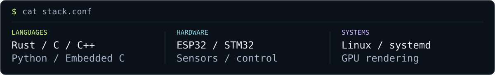

<picture>
  <source media="(max-width: 600px)" srcset="assets/header-mobile.svg">
  
</picture>

<h3><samp>$ cat about.txt</samp></h3>

I build where software meets the physical world: Linux talking to unsupported hardware, vision running on microcontrollers, and robots learning to move. I like understanding the entire path — from a sensor reading or a byte on the wire to the thing you see on screen.

<picture>
  <source media="(max-width: 600px)" srcset="assets/stack-mobile.svg">
  
</picture>

<samp>$ open</samp> &nbsp; <a href="mailto:arnabranjan.sikdar@gmail.com">Email ↗</a> &nbsp; / &nbsp; <a href="https://www.linkedin.com/in/arnab-ranjan-sikdar/">LinkedIn ↗</a>

## Selected projects

### [hashi ↗](https://github.com/ASPRNG-PRGMR/hashi) · Flagship

Turns an iPad into a USB extended display for Linux, with touch input. My flagship project so far, with plans to integrate it more closely into Linux, focusing on Fedora and Arch.

Python · C++ · Rust · Wayland · Hardware-tested alpha

| Project | What I'm building and why |
| :--- | :--- |
| **[ASHA ↗](https://github.com/ASPRNG-PRGMR/asha)** | My main focus right now: a university robotics lab project developing a Booster T1 humanoid for routine hospital support. Currently working on arm control and tray handling, with motion validated in simulation before hardware testing. C++ · ROS 2 · Gazebo · RGB-D perception |
| **[EdgeCV ↗](https://github.com/ASPRNG-PRGMR/EdgeCV)** | My internship project: running computer vision directly on ESP32 camera hardware, offline. Still needs a lot of polishing. C++ · ESP32 · TensorFlow Lite Micro |
| **[smart_meter / VoltGuard ↗](https://github.com/ASPRNG-PRGMR/smart_meter)** | Our smart-metering project with tamper detection, encrypted telemetry, and a monitoring dashboard. It got our team into **6 hackathons: 3 wins and 3 finalist finishes**. Forked from AkiiPanicker/smart_meter · Embedded C · Python |
| **[senpai ↗](https://github.com/ASPRNG-PRGMR/senpai)** | My attempt to make working with PDFs on Windows a bit better. A native document reader with a Rust core and Poppler rendering, still in early development. Rust · C++ · egui |
| **[HomeNAS ↗](https://github.com/ASPRNG-PRGMR/HomeNAS)** | My first project exploring C++ and reverse proxies: turning a Linux machine into a home NAS with remote access. C++ · Linux · NGINX · Tailscale |
| **[PointerForce ↗](https://github.com/ASPRNG-PRGMR/PointerForce)** | A way into driver programming, built around per-device Linux input mapping and live controls. |
| **[kage ↗](https://github.com/ASPRNG-PRGMR/kage)** | An experimental text-rendering engine for exploring OLED subpixel layouts and GPU rendering. Rust · OpenGL · Vulkan |

---

Understand the hardware. Trace the signal. Build the whole thing.

<!-- Artwork is local, self-contained SVG. Edit scripts/build_assets.py and run
     python3 scripts/build_assets.py to regenerate the headers, stack panels, and folder icons. -->
