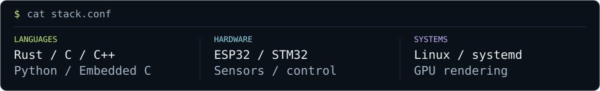

<picture>
  <source media="(max-width: 600px)" srcset="assets/header-mobile.svg">
  
</picture>

<h3><samp>$ cat about.txt</samp></h3>

I build where software meets the physical world: Linux talking to unsupported hardware, vision running on microcontrollers, and robots learning to move. I like understanding the entire path — from a sensor reading or a byte on the wire to the thing you see on screen.

<picture>
  <source media="(max-width: 600px)" srcset="assets/stack-mobile.svg">
  
</picture>

<samp>$ open</samp> &nbsp; <a href="mailto:arnabranjan.sikdar@gmail.com">Email ↗</a> &nbsp; / &nbsp; <a href="https://www.linkedin.com/in/arnab-ranjan-sikdar/">LinkedIn ↗</a>

## Projects

<h3> Linux, graphics &amp; infrastructure</h3>

| Project | Focus |
| :--- | :--- |
| [HASHI](https://github.com/ASPRNG-PRGMR/hashi) | An iPad as a USB extended display for Linux, with touch input. Hardware-tested alpha. |
| [KAGE](https://github.com/ASPRNG-PRGMR/kage) | OLED-aware text rendering and physical subpixel simulation in Rust, with OpenGL and Vulkan backends. |
| [SENPAI](https://github.com/ASPRNG-PRGMR/senpai) | A native document reader with a Rust core and Poppler rendering; early development. |
| [PointerForce](https://github.com/ASPRNG-PRGMR/PointerForce) | Per-device Linux input mapping with a live control plane. |
| [PinchKey](https://github.com/ASPRNG-PRGMR/PinchKey) | Native browser pinch zoom from a mouse wheel, through a virtual touchpad. |
| [OMEN RGB](https://github.com/ASPRNG-PRGMR/omen-rgb-keyboard) | A Linux kernel driver for HP OMEN four-zone keyboard lighting, inspired by `hp-omen-linux-module`. |
| [HomeNAS](https://github.com/ASPRNG-PRGMR/HomeNAS) | A self-hosted NAS with audit logging, attack detection, and an investigation console. |
| [HeteroWise](https://github.com/ASPRNG-PRGMR/HeteroWise) | Energy-aware workload placement across AMD CPU, GPU, and NPU targets. |

<h3> Robotics, sensing &amp; control</h3>

| Project | Focus |
| :--- | :--- |
| [EdgeRover](https://github.com/ASPRNG-PRGMR/EdgeRover) | A four-wheel rover with ESP-NOW control and AprilTag follower firmware; bench testing pending. |
| [BhuKavach](https://github.com/ASPRNG-PRGMR/bhukavach) | Ground-deformation reconstruction from a mesh of tilt sensors; simulation validated, not field validated. |
| [Green Dot](https://github.com/ASPRNG-PRGMR/greenDot) | ESP32 attitude-control firmware and an ESP-NOW hand controller; hardware validation pending. |
| [TEAM-SILICA](https://github.com/ASPRNG-PRGMR/TEAM-SILICA) | A bare-metal STM32 motor-control ECU with explicit states and emergency handling. |
| [VoltGuard](https://github.com/ASPRNG-PRGMR/smart_meter) | Smart-metering fork: multi-sensor tamper detection, encrypted telemetry, and a monitoring dashboard. |
| [SemantiCAN](https://github.com/ASPRNG-PRGMR/SemantiCAN) | Semantic anomaly detection in simulated vehicle telemetry using rules and a local LSTM. |
| [CSI Project](https://github.com/ASPRNG-PRGMR/csi_project) | Wi-Fi channel-state acquisition and visualization with Raspberry Pi / Nexmon and ESP32. |

<h3> Embedded vision &amp; team builds</h3>

| Project | Focus |
| :--- | :--- |
| [EdgeCV](https://github.com/ASPRNG-PRGMR/EdgeCV) | Offline image classification on ESP32 camera hardware using TensorFlow Lite Micro. |
| [ANAJ-AI](https://github.com/ASPRNG-PRGMR/ANAJ-AI) | Crop-disease inference split across an ESP32-S3-CAM and Arduino Uno; hardware integration in progress. |
| [SHUWA](https://github.com/ASPRNG-PRGMR/shuwa) | Sign-language recognition with an ESP32 camera feed, PC-side landmarks, and temporal modeling. |
| [Binary Bin / nullVoid](https://github.com/ASPRNG-PRGMR/TEAM-nullVoid) | A smart waste-sorting bin. Team build: **3rd place**, four-hour Buildathon 2026. |

<h3> Forks &amp; upstream exploration</h3>

My [OMEN Space fork](https://github.com/ASPRNG-PRGMR/omen-space) builds on [yunusemreyl/omen-space](https://github.com/yunusemreyl/omen-space), a native Linux control center for HP laptops.

The wider workbench also includes upstream checkouts of [Gaze](https://github.com/GunduLabs/gaze), [RealSense SDK](https://github.com/realsenseai/librealsense), [AprilTag](https://github.com/AprilRobotics/apriltag), [AprilTag for ESP32](https://github.com/raspiduino/apriltag-esp32), [TensorRT](https://github.com/NVIDIA/TensorRT), and [Booster train](https://github.com/BoosterRobotics/booster_train). These are other teams' projects, explored alongside my own work.

---

Understand the hardware. Trace the signal. Build the whole thing.

<!-- Artwork is local, self-contained SVG. Edit scripts/build_assets.py and run
     python3 scripts/build_assets.py to regenerate the headers, stack panels, and folder icons. -->
